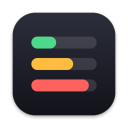
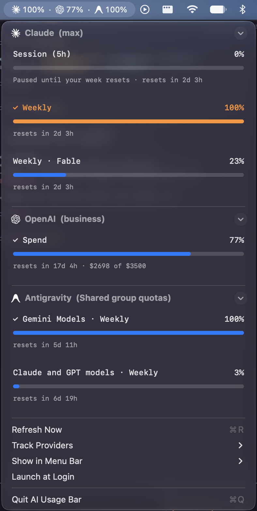

<p align="center"></p>

<h1 align="center">AI Usage Bar</h1>

A native macOS menu-bar app that shows your **current subscription usage** for
**Claude**, **OpenAI/ChatGPT**, and **Antigravity** side by side — usage windows
from Claude Code and Codex, plus shared quota groups from Antigravity's `agy` CLI,
always visible in the menu bar.

- Track only the providers you use, and choose which appear in the menu bar.
- Pin a usage window independently for each provider.
- Collapse provider sections to keep the dropdown compact.
- Refresh automatically every **120 seconds**, with last-good values retained on errors.

A compact title shows each provider's usage in the menu bar. Click it to open
the full breakdown with usage bars and reset countdowns:

<div align="center" style="text-align:center">
  
</div>

The screenshot shows **Claude Max**, **OpenAI Business**, and **Antigravity**.
OpenAI Business shows a monthly **Spend** cap instead of Plus/Pro's rolling
5-hour + Weekly windows; Antigravity shows shared quota groups for Gemini and
Claude/GPT models.

Each usage row is clickable: click one to pin it as that provider's menu-bar
percentage; click it again to revert to auto (highest window). A `✓` always
marks the window currently shown in the menu bar — the pinned row, or the
auto-selected one when unpinned — and each provider's selection is independent.
The window currently binding your usage (the API's `is_active` flag) is drawn in
**orange**.

Click a provider's header to collapse or expand its details. Sections start
expanded and remember your choice; collapsing does not stop refreshes or change
the menu-bar percentage.

## Install

### Homebrew (recommended)

```bash
brew install --cask guilospanck/tap/ai-usage-bar
open "/Applications/AI Usage Bar.app"
```

This taps [`Guilospanck/homebrew-tap`](https://github.com/Guilospanck/homebrew-tap)
and installs the prebuilt `.app` into `/Applications` — **no Swift toolchain
required**. The cask clears the download quarantine on install so Gatekeeper
lets it launch (the app is ad-hoc signed, not notarized).

Upgrade or remove it the usual `brew` way:

```bash
brew upgrade --cask ai-usage-bar
brew uninstall --cask ai-usage-bar        # turn off Launch at Login first
```

### Provider setup

Requires **macOS 13 or later**. Sign in with the CLI for each provider you want
to track (this applies to both Homebrew and source installs):

- **Claude:** run `claude auth login` (Pro/Max).
- **OpenAI/ChatGPT:** run `codex` and authenticate (Plus/Pro/Business).
- **Antigravity:** install `agy` **1.3.5 or later** and run it once to sign in.

All providers are tracked by default. Turn off unused providers in **Track
Providers** to avoid checking their credentials or running their CLI.

### Build from source

Additional requirements:

- A **Swift toolchain** — Xcode 15+ or the standalone toolchain (`swift --version`).
  If missing: `xcode-select --install`. *(Only needed to build from source — the
  Homebrew cask ships a prebuilt binary.)*
- Optional: [`just`](https://github.com/casey/just) for the task recipes — `brew install just`

From the repository root (the folder containing `Package.swift`):

```bash
just install          # build (release) + bundle + ad-hoc sign + copy to /Applications
open "/Applications/AI Usage Bar.app"
```

Without `just`, the equivalent is:

```bash
./build.sh
cp -R "build.noindex/AI Usage Bar.app" /Applications/
open "/Applications/AI Usage Bar.app"
```

The app appears in the **menu bar** (no Dock icon).

- **Start at boot:** click the menu-bar item → **Launch at Login**.

Because you build it locally, Gatekeeper does **not** block it (no quarantine flag),
so `open` just works. The ad-hoc signature is fine for personal use but is **not
notarized** — don't redistribute the `.app` to other Macs as-is.

### Updating

```bash
just restart          # rebuild + relaunch the running copy
just install          # refresh the /Applications copy
```

### Uninstalling

Turn off **Launch at Login** in the menu first, then:

```bash
just uninstall        # or: rm -rf "/Applications/AI Usage Bar.app"
```

### Quick sanity check (no GUI)

Verify credentials + endpoints straight from the terminal:

```bash
just probe            # or: swift run AIUsageBar --probe
just dump             # raw HTTP responses / agy quota report, for debugging
```

`probe` prints each provider's plan, windows, and reset countdowns — the fastest
way to confirm credentials and usage fetching work before worrying about the UI.
Both commands respect **Track Providers** settings. `dump` output may include
personal information (email or account IDs); redact it before sharing.

## How it works

No API keys required. For Claude and OpenAI, it reuses the OAuth tokens the
official CLIs already store and calls their undocumented usage endpoints.
For Antigravity, it delegates usage fetching and authentication to `agy`:

| Provider | Endpoint | Token source |
|----------|----------|--------------|
| Claude   | `GET api.anthropic.com/api/oauth/usage` | Keychain `Claude Code-credentials` for account `$USER` (read via `/usr/bin/security`), fallback `~/.claude/.credentials.json` |
| OpenAI   | `GET chatgpt.com/backend-api/wham/usage` | `~/.codex/auth.json` |
| Antigravity | `agy -p /usage --output-format json` | Managed by `agy` |

It re-reads Claude and OpenAI tokens on every poll, relying on their CLIs to keep
them fresh.
Claude credentials are located the way Claude Code does it: with `CLAUDE_CONFIG_DIR`
set, the Keychain item gets a hash suffix and the file lives in that directory.
Apps launched from Finder or at login don't see shell variables, so only the default
`~/.claude` setup works there; a custom config dir is picked up when you run the
binary from a terminal (e.g. `--probe`).
Poll interval defaults to **120s**; last-good values are kept on network/429 errors.

For **Claude**, usage is read from the endpoint's structured `limits[]` array, which
exposes the 5-hour session window, the all-model weekly cap, **and per-model weekly
caps** (e.g. **Fable**) via each entry's `scope.model.display_name`. Any additional
model-scoped caps your plan has appear automatically — nothing is hard-coded to Fable.

**Tracking providers:** open **Track Providers** to choose which providers the app
checks. All are tracked by default and choices are saved. Unchecked providers
are removed from the dropdown and title, their active checks are cancelled, and
neither automatic nor manual refresh accesses them. Re-enabling a provider checks
it immediately. `--probe` and `--dump` also respect these choices. With none
selected, the **AI** title keeps the menu accessible.

**Choosing menu-bar visibility:** open **Show in Menu Bar** in the dropdown to toggle Claude,
OpenAI, and Antigravity independently. All are shown by default and choices are
saved. Hidden providers still refresh and remain in the dropdown. Untracked
providers cannot be toggled here; re-enable them in **Track Providers** first.
Hiding all providers leaves an **AI** title so the menu stays accessible.

**Choosing what the menu-bar shows:** the compact percentage defaults to the *highest*
window for each provider. Click any usage row in the dropdown to pin that window instead;
click the pinned row again to go back to auto. Each provider's choice is saved
independently. If a pinned window disappears from that provider's report, the
menu-bar percentage falls back to its highest available window.

### Antigravity

Install `agy` and run it once to sign in. The app runs
`agy -p /usage --output-format json` on each poll and reads its structured quota
report. This is a built-in usage command, not a model prompt. Tested with `agy`
1.3.5; older versions without structured `/usage` reports must be updated.

The rows show **shared quota groups** (Gemini and Claude/GPT), with weekly and
session limits when reported. They are not summed into a fictitious account-wide
percentage. Remaining fractions are converted to percent used.

`agy` owns authentication and token refresh: no OAuth client configuration file
or manual hourly launch is required while silent refresh succeeds. When sign-in
is needed again, run `agy` in a terminal. Automatic probes block browser launch
via PATH/BROWSER shims, use a private temporary working directory, cap output at
1 MiB per stream, and time out after 75 seconds. Last-good values are retained
on failures. CLI startup may load its configured plugins/MCP servers.

The app finds `agy` on PATH, in `~/.local/bin`, `~/.antigravity/bin`, or standard
Homebrew locations. Terminal launches can set `ANTIGRAVITY_CLI_PATH` to an
absolute executable path. Finder/login launches do not inherit shell variables.

## Troubleshooting

- **Keychain prompt naming `security` for "Claude Code-credentials" — click
  Deny.** AI Usage Bar never needs this prompt: it reads the token through
  `/usr/bin/security`, which Claude Code puts on the item's access list when it
  creates the item. A prompt means `security` isn't on that list (the item was
  imported, restored, or its access list was edited) **or another process is
  trying to read your token** — the dialog can't tell you which process asked.
  - Don't click **Allow** or **Always Allow**. *Always Allow* trusts the
    `security` tool itself, not AI Usage Bar, so every process running as your
    user could read the token without asking from then on.
  - To fix it, have Claude Code recreate the item: `claude auth logout`, then
    `claude auth login`.

  After a denial the menu shows "Keychain access denied"; an unanswered prompt
  gives up after 30s ("Keychain read timed out"). Either way Claude stops
  refreshing automatically, so the prompt doesn't keep coming back — its
  menu-bar number gets a ⏸ and stays at the last value. Click **Refresh Now**
  to try again.
- **Old AI Usage Bar entries in the item's access list** — earlier versions
  read the Keychain directly, so *Keychain Access → Claude
  Code-credentials → Access Control* may list `AI Usage Bar.app` / `AIUsageBar`.
  You can remove them once no older copy of the app is in use (don't remove
  `security`, and leave any Claude entries alone).
- **Claude shows "Keychain locked"** — unlock the login keychain (logging in
  normally does it) and wait for the next poll.
- **Claude shows "Keychain access denied"** — see the Keychain prompt item above.
- **Claude shows "Not signed in"** — run `claude` once and authenticate. With a
  custom `CLAUDE_CONFIG_DIR`, see *How it works* above.
- **OpenAI shows "Not signed in"** — run `codex` once and authenticate so
  `~/.codex/auth.json` exists.
- **Antigravity cannot find `agy` or needs sign-in** — install/update `agy`, then
  run it in a terminal to authenticate. For a nonstandard install location, see
  `ANTIGRAVITY_CLI_PATH` above.
- **Provider missing from the dropdown** — enable it in **Track Providers**.
  If only its details are missing, click the provider header to expand it.
- **Provider missing only from the menu bar** — enable it in **Show in Menu Bar**.
- **OpenAI plan shape** — Plus/Pro report rolling **5-hour + Weekly** windows;
  **Business/enterprise** plans return `rate_limit: null` and instead expose a
  monthly **Spend** cap (shown as a "Spend" row with `$used of $limit`). If OpenAI
  shows "No data", run `just dump` and check which shape your account returns.
- **"Re-auth needed" (401)** — the stored token expired; open the relevant CLI to
  refresh it. Antigravity delegates silent refresh to `agy`.
- **"Rate limited" (429)** — the usage endpoints throttle aggressive polling;
  the app keeps the last-good values. Leave the interval at 120s or higher.
- **Launch at Login item missing/ineffective** — this needs the bundled, signed
  `.app` from `build.sh`, not a bare `swift run` binary.

## Project layout

```
Package.swift                     SwiftPM executable (macOS 13+)
Info.plist                        LSUIElement agent + bundle id
build.sh                          build + bundle + ad-hoc sign
Resources/AppIcon.icns            app icon (regenerate: `just icon`)
scripts/make-icon.swift           draws the icon + writes the .icns
Sources/AIUsageBar/
  App.swift                       entry point (+ --probe / --dump modes)
  AppDelegate.swift               NSStatusItem, menu, rendering
  UsageStore.swift                provider registry + polling loop
  Settings.swift                  saved tracking, visibility, pins, collapse state
  ProviderIcon.swift              provider logos
  ProviderHeaderView.swift        clickable, collapsible section headers
  QuotaMenuItemView.swift          usage bars + clickable window rows
  Formatting.swift                title / bar / countdown helpers
  Models.swift                    UsageWindow, ProviderUsage, errors
  LoginItem.swift                 SMAppService launch-at-login
  Providers/
    Provider.swift                protocol + shared HTTP helpers
    AnthropicProvider.swift       Claude usage fetch + parse
    OpenAIProvider.swift          OpenAI usage fetch + parse
    AntigravityProvider.swift     structured quota report parser
    AntigravityUsageCommand.swift bounded agy subprocess + executable discovery
  Credentials/
    ClaudeCredentials.swift       Keychain + file token reader
    CodexCredentials.swift        auth.json (+ JWT account-id) reader
```

## Extending

Adding a provider is: implement `UsageProvider`, return a `ProviderUsage`, and add
a case to `ProviderKind`, supply its icon in `ProviderIcon.swift`, and register
it in `AppDelegate`'s `UsageStore(...)` init and `App.swift`'s headless modes.
Tracking and visibility menus are generated from `ProviderKind.allCases`.
A future **API/$-spend
mode** (Anthropic Admin key, OpenAI usage API) would slot in as additional
providers alongside the subscription ones.
